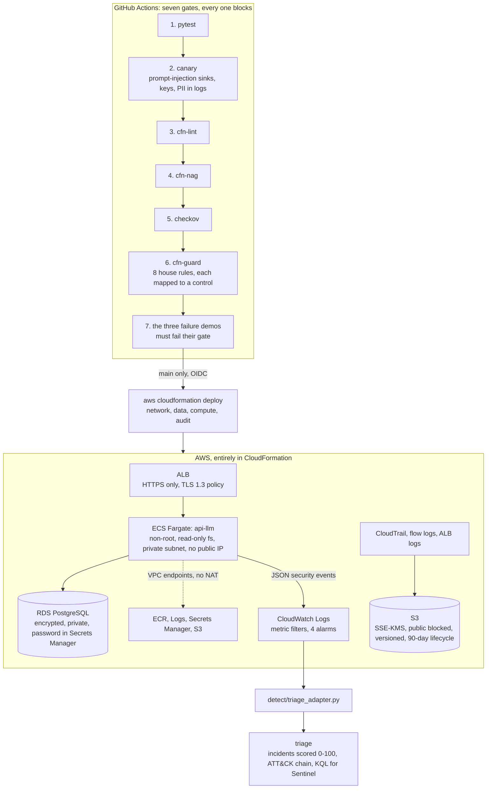

# forge

[](https://github.com/jcedrik/forge/actions/workflows/ci.yaml)
[](LICENSE)


A delivery pipeline that **refuses insecure code at build**, **deploys
infrastructure that is compliant by construction**, and **detects attacks at
runtime**. One small LLM API is the target; the pipeline is the point.

```
git push  ->  tests  ->  canary  ->  cfn-lint  ->  cfn-nag  ->  checkov  ->  cfn-guard  ->  deploy  ->  triage
              fails     refuses                                                 refuses       4 stacks    correlates
```



**90-second video of the three gates refusing:** _link goes here after recording `make demo`_

## The three failure demos

| Mistake committed | Gate | What happens |
|---|---|---|
| User text spliced into the system prompt, an `sk-proj-...` key in source, the prompt printed to logs | canary | Build fails with `CANARY-PI-001` High and `CANARY-SEC-001` Critical, findings in the Security tab. No image is built. |
| `BlockPublicAcls: false` on the logs bucket, port 22 open to the world on the ECS security group | cfn-guard | `s3-block-public (PCI DSS 1.3, NIST AC-3)` and `sg-no-open-admin (PCI DSS 1.2, NIST SC-7)` fail. CloudFormation is never invoked. |
| Six bad-token requests, two prompt injections and an oversized request from one client in one minute | triage | Nine alerts become one incident, risk 92/100, Credential Access -> Execution -> Impact. One page, not nine. |

```bash
make demo
```

runs all three locally in about ten seconds, and CI runs them on every push:
the pipeline tests its own gates. Details and the patches in [`demo/`](demo/README.md).

## Quickstart

```bash
pip install -r app/requirements.txt -r requirements-dev.txt
make verify                                  # seven gates, locally, ~90 s
make run                                     # the API on :8000 with the stub model, zero API cost
make deploy CERT_ARN=arn:aws:acm:...         # four stacks, under 20 minutes
make destroy                                 # everything gone, verified
```

[`RUNBOOK.md`](RUNBOOK.md) has the first-deploy ordering, the OIDC setup for
CI, and the three most likely failures with their fixes.

## Numbers

| | Value | Where measured |
|---|---:|---|
| Gates | 7, all blocking | `.github/workflows/ci.yaml` |
| House guard rules, each mapped to PCI DSS / NIST / ISO / HIPAA | 8 (+3 companions) | `infra/guard-rules/`, `docs/compliance-matrix.md` |
| Findings blocked at build during this project's own development | 2 secrets, 1 injection sink, 2 template violations | the demo patches are the ones that were caught |
| Application tests | 12 | `app/tests/` |
| Local verify, cold | ~90 s | `make verify` |
| Pipeline push to healthy, first deploy | ~20 min (RDS is 8 of them) | `RUNBOOK.md` |
| `/chat` latency with the stub model, p50 / p95 | 3 ms / 6 ms | `/metrics` after `make demo` |
| Demo 3: alerts in / incidents out / top risk | 9 / 1 / 92 | `demo/03-attack-simulation.sh` |
| Monthly cost, running | ~107 USD list (~93 with RDS free tier) | [`COST.md`](COST.md) |
| Monthly cost after `make destroy` | 0, verified by `infra/destroy.sh` | [`COST.md`](COST.md) |

The "measured in AWS" column (deploy time, real latency behind the ALB, Cost
Explorer after 30 days) is filled in after the first production run; the
template for it is in `COST.md`.

## What is in the box

```
app/            FastAPI target: POST /chat with four guardrails, /healthz, /metrics, JSON security events
infra/          four CloudFormation stacks + guard-rules/ (cfn-guard) + destroy.sh
detect/         CloudWatch -> triage adapter; KQL lands in Sentinel
demo/           the three failure patches and the attack simulation
docs/           compliance-matrix.md, events.md
.github/        the pipeline
COST.md         line by line, running and after teardown
SCALE.md        where this design breaks at 100x, and what changes
RUNBOOK.md      deploy, destroy, debug
```

### The target: `api-llm`

A deliberately small FastAPI service with the four guardrails that matter on
an LLM endpoint, each one emitting a structured event when it fires:

| Guardrail | Event | What it does |
|---|---|---|
| Input size and type | `input.oversize` | 4,000-character cap before anything else runs |
| Prompt injection patterns | `prompt.injection_detected` | override / role-hijack / prompt-leak / delimiter patterns refused with a 400 |
| Per-client rate limit | `ratelimit.exceeded` | sliding window, 30 per minute by default |
| Output PII redaction | `output.pii_redacted` | email, phone, SIN, card, API keys replaced before the answer leaves |

User text goes to the model as its own `user` message, never inside the
system prompt. The prompt and the answer are never logged and never stored;
the database keeps request metadata only. canary enforces both in CI.

### The infrastructure: compliant by construction

Four stacks, no console clicks. The private subnets have no route to the
internet at all: tasks reach ECR, Logs, Secrets Manager and S3 through VPC
endpoints, which is also cheaper than a NAT Gateway. The ALB speaks HTTPS
only; there is no port 80. Tasks run as uid 10001 on a read-only root
filesystem with every capability dropped. Every secret is generated in
Secrets Manager and injected at task start. One KMS key with rotation
encrypts S3, RDS, logs, SNS and ECR. CloudTrail with log file validation,
VPC flow logs and ALB access logs land in a bucket with all four public
blocks, versioning and a 90-day lifecycle.

cfn-lint and checkov pass clean (three documented exceptions, each a cost
decision). The eight cfn-guard rules are the house policy, and each one
names the control it implements:

| Rule | Refuses | Control |
|---|---|---|
| `s3-block-public` | any public-access flag off | PCI DSS 1.3, NIST AC-3 |
| `s3-encryption` | a bucket not on SSE-KMS | PCI DSS 3.5, ISO 27001 A.8.24 |
| `rds-encrypted` | unencrypted storage | PCI DSS 3.5, HIPAA 164.312(a)(2)(iv) |
| `rds-not-public` | `PubliclyAccessible: true` | NIST SC-7 |
| `sg-no-open-admin` | 22, 3389 or all traffic from 0.0.0.0/0 | PCI DSS 1.2, NIST SC-7 |
| `iam-no-wildcard` | `Action: "*"` | NIST AC-6, ISO 27001 A.5.15 |
| `ecs-no-root` | root user, writable root fs, privileged | NIST CM-7 |
| `cloudtrail-validation` | no log validation, single region, unencrypted | PCI DSS 10.5, NIST AU-9 |

### The detection: runtime events into incidents

The app writes one JSON line per security event. CloudWatch metric filters
turn them into four alarms (auth failures, injection bursts, 5xx, unhealthy
hosts). `detect/triage_adapter.py` pulls the same events into
[triage](https://github.com/jcedrik/triage), which correlates them by client
and time, scores the incident 0 to 100, maps it onto ATT&CK, and writes a
KQL hunting query so the same incident can be opened in Microsoft Sentinel.

## Failure modes

| What fails | What happens | How you know |
|---|---|---|
| A Fargate task dies | ECS replaces it; the ALB stops routing to it after 3 failed checks (45 s) | `UnHealthyHostCount` alarm |
| RDS unreachable | `/chat` still answers; the metadata insert fails and emits `db.query_error`; `/healthz` returns 503 so the ALB drains the task | `/healthz` body, alarm on 5xx |
| Model provider down | 502 with `model.error`, no retry storm (one call per request) | `model_error` counter in `/metrics` |
| Secrets Manager unreachable at task start | task fails to start, deployment circuit breaker rolls back to the previous task definition | ECS service events |
| A gate has a false positive | the push is blocked; inline `# canary: ignore` or a documented checkov skip, both visible in review | the PR check |
| Someone deletes the logs bucket | they cannot while the stack exists (versioning + policy); `make destroy` is the only path and it empties it on purpose | CloudTrail |

## At 100x

The rate limiter is per task and breaks with the second task; the answer is
WAF. Interface endpoints are half the bill. The pull-based detection path
becomes a subscription filter into Firehose. Eight guard rules become a
control catalogue. All of it, with the reasoning, in [`SCALE.md`](SCALE.md).

## What I would do differently

Start with the demos. I wrote the templates first and the three failure
patches last, and the patches are what made the rules honest: two of the
eight guard rules had gaps (standalone `SecurityGroupIngress` resources,
`Fn::Sub`-wrapped secret references) that only showed up when I tried to
sneak something past them. Next time the failure cases come first and the
rules are written to catch them.

## License

MIT
